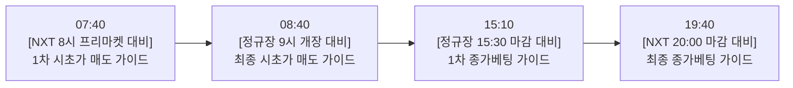

# 📘 비니stock 주식 자동화 텔레그램 봇 시스템 가이드 설명서

본 문서는 **종가베팅(오버나잇) 진입**과 **장 시작 전 시초가 분할 매도 타이밍**을 실시간 데이터 기반으로 판단하여 텔레그램으로 배달해 주는 자동화 시스템의 전체 구조와 사용 설명서입니다.

---

## 1. 💡 시스템 핵심 요약

| 항목 | 내용 |
| :--- | :--- |
| **운영 비용** | **월 0원 (완전 무료)** — 유료 AI 호출 없음, 공개 금융 API + GitHub Actions 무료 티어 사용 |
| **운영 방식** | **100% 클라우드 무중단 자동화** — 내 컴퓨터를 꺼두어도 깃허브 서버가 정해진 시간에 자동 실행 |
| **알림 채널** | 텔레그램 **`비니stock` 단체방** (`-1003844905961`) |
| **핵심 철학** | 복잡한 거시경제 사설 대신 **[E-mini 나스닥 100 선물 + 필라델피아 반도체 + 외인·기관 수급]** 3대 핵심 팩트 기반 명쾌한 행동 지침 |

---

## 2. ⏱️ 하루 4회 실전 트레이딩 타임테이블

Nextrade(대체거래소)와 KRX(한국거래소) 정규장 운영 시간에 맞춘 4대 라이프사이클입니다.



### ① 🌅 [아침 07:40] 08:00 NXT 프리마켓 개장 전 시초가 매도 가이드
* **목적**: 08:00에 개장하는 대체거래소(NXT) 프리마켓 거래 직전, 어제 오버나잇한 종목의 1차 매도 판단
* **핵심 체크**: 밤사이 미 나스닥 마감, **필라델피아 반도체 지수(SOX)**, 07:40 실시간 미 선물, 원/달러 환율
* **액션**: 08:00 개장 땡 쳤을 때 선제적 갭상승 슈팅 분할 익절 여부 결정

### ② 🌅 [아침 08:40] 09:00 정규장 개장 전 최종 매도 가이드
* **목적**: 08:30~09:00 KRX 장전 동시호가 호가창 확인 및 09:00 정규장 개장 직전 최종 행동 지침
* **핵심 체크**: 08:00~08:40 NXT 장전 프리마켓 흐름 + 최신 실시간 미 선물 변동치
* **액션**: 09:00 정규장 개장 직후 5~10분간 갭상승 50~70% 적극 분할 익절 vs 갭하락 시 09:15 첫 반등 정리 원칙

### ③ 🎯 [오후 15:10] 15:30 정규장 마감 1차 종가베팅 가이드
* **목적**: 15:20 정규장 동시호가 진입 10분 전, 오늘 종가베팅(오버나잇) 진입 여부 및 비중 결정
* **핵심 체크**: 오늘 코스피/코스닥 **외국인·기관 메이저 양매수 여부**, 실시간 미 나스닥 100 야간 선물, 당일 지수 마감선
* **액션**: 정규장 주도 대장주를 1차로 담을지(비중 60~80%), 소액만 선별할지(30~50%), 전량 현금화할지 결정

### ④ 🎯 [오후 19:40] 20:00 NXT 8시 마감 최종 종가베팅 가이드
* **목적**: 20:00(오후 8시) Nextrade 및 야간 시간외 거래 종료 20분 전, 내일 아침까지 들고 갈 최종 오버나잇 결정
* **핵심 체크**: 장 마감 후 발표된 **호재 공시(어닝 서프라이즈 실적, 자사주 취득)** + **실시간 미국 나스닥 선물 추세** + 유럽 증시
* **액션**: 20:00 거래 마감 전 최종 종가베팅 매수 완료 또는 야간 리스크 감지 시 전량 현금화

---

## 3. 📂 파일 구조 및 코드 역할 설명

프로젝트 폴더 내 각 파일들이 담당하는 역할입니다:

```
Stock-News-and-Schedule/
├── .github/workflows/
│   ├── market-score.yml       # ⏰ 매일 07:40, 08:40, 15:10, 19:40 자동 실행기
│   ├── disclosure-alert.yml   # ⏰ 매일 07:10(IR 요약), 15:00 공시 알림 자동 실행기
│   └── daily-telegram.yml     # ⏰ 매일 07:00 뉴스+날씨+주요경제지표 브리핑 실행기
├── src/
│   ├── market_score.py        # 🧭 실시간 시황 점수(0~100점) & 4대 매매 알고리즘
│   ├── disclosure.py          # 📑 OpenDART 전자공시(실적 어닝/자사주/IR) 수집 및 가공
│   ├── crawler.py             # 🌐 ForexFactory & TradingEconomics 경제지표 크롤러
│   ├── weather.py             # ☀️ 기상청 날씨 데이터 수집 모듈
│   ├── config.py              # ⚙️ 환경변수 로딩 및 검증 모듈
│   └── telegram_sender.py     # 📲 텔레그램 메시지 안전 발송 모듈
├── market_alert.py            # 🚀 시황/종가베팅 모듈을 실행해 텔레그램으로 전송하는 스크립트
├── disclosure_alert.py        # 🚀 전자공시 알림을 실행해 텔레그램으로 전송하는 스크립트
├── daily_digest.py            # 🚀 아침 종합 브리핑을 실행해 텔레그램으로 전송하는 스크립트
├── watchlist.txt              # 📋 공시를 추적할 관심종목 리스트
└── .env                       # 🔑 텔레그램 토큰, Chat ID, DART API 키 등 보안 설정
```

---

## 4. 🧮 점수 산출 공식 및 신호 보는 법

### 📊 시황/종가베팅 점수 (0 ~ 100점)

점수는 가상의 감이 아니라, 실제 시장에서 체결 중인 수치들을 가중 평균하여 산출합니다:

1. **CME E-mini 나스닥 100 선물 (`NQ=F`) — 가중치 35~45%**
   * 전 세계 스마트머니가 지금 당장 돈을 걸고 있는 실시간 위험선호 지표.
   * 선물이 `+0.5%` 이상이면 가산점 부여, `-0.5%` 이하로 급락하면 대폭 감점.
2. **외인·기관 메이저 수급 (코스피/코스닥) — 가중치 35% (오후)**
   * 개인만 홀로 매수하고 메이저가 팔면 감점.
   * 외인과 기관이 동반 순매수(양매수)하며 지수를 끌어올리면 만점 가산.
3. **필라델피아 반도체 지수 (`SOX`) — 가중치 25% (아침)**
   * 한국 증시 시가총액의 35% 이상을 차지하는 삼성전자, SK하이닉스 및 소부장 시초가 결정타.
4. **원/달러 환율 (`USDKRW`) — 가중치 15~20%**
   * 환율 급등(원화 약세) 시 외인 이탈 우려로 감점, 환율 안정 시 가산점.

### 🚦 점수 구간별 행동 수칙 매뉴얼

| 점수 구간 | 게이지 & 신호 | 실전 행동 수칙 |
| :---: | :---: | :--- |
| **75점 이상** | `[■■■■■■■■░░]`<br>🟢 **적극 베팅** | • **종가베팅**: 총 투자금의 **60~80%** 적극 투입. 당일 거래대금 최상위 및 신고가 주도주 오버나잇.<br>• **시초가 매도**: 개장 직후 5~10분 갭 띄울 때 **50~70% 적극 분할 익절**. |
| **55 ~ 74점** | `[■■■■■■░░░░]`<br>🟡 **선별 베팅** | • **종가베팅**: 비중을 **30~50%**로 조절. 지수 연동형 대형주 대신 **호재 공시(어닝 서프라이즈, 자사주 취득)**가 뜬 개별주 중심 소액 공략.<br>• **시초가 매도**: +2~+4% 슈팅 구간 분할 익절 후 시초가 이탈 시 본절. |
| **40 ~ 54점** | `[■■■■░░░░░░]`<br>🟠 **보수적 접근** | • **종가베팅**: 비중 **20% 이하** 또는 **현금 관망**. 시장 에너지가 분산되어 오버나잇 리스크 존재.<br>• **시초가 매도**: 뇌동매매 금지, 첫 5분간 수급 지켜본 뒤 본절 방어. |
| **40점 미만** | `[■■░░░░░░░░]`<br>🔴 **베팅 금지** | • **종가베팅**: **오버나잇 절대 금지 (전량 현금 100%)**. 미 선물 급락 또는 메이저 양매도로 익일 갭하락 위험 극대화.<br>• **시초가 매도**: 패닉셀 금지. 09:10~09:20경 나오는 **첫 기술적 반등 파동**에서 분할 손절/현금화. |

---

## 5. 🛠️ 유지보수 및 설정 변경 방법

### ① 관심 종목 추가 / 삭제
[watchlist.txt](file:///c:/Users/Admin/binistock/Stock-News-and-Schedule/watchlist.txt) 파일을 열고 한 줄에 하나씩 종목명을 입력하시면 공시 감시 대상에 즉시 반영됩니다:
```text
삼성전자
SK하이닉스
씨피시스템
인화정공
```

### ② 텔레그램 수신 방 변경 (필요 시)
현재는 `비니stock` 그룹방(`-1003844905961`)으로 고정되어 있습니다. 
만약 다른 방으로 바꾸고 싶다면:
1. 로컬 PC: [.env](file:///c:/Users/Admin/binistock/Stock-News-and-Schedule/.env) 파일의 `TELEGRAM_CHAT_ID` 수정
2. 깃허브: GitHub 저장소 > **Settings** > **Secrets and variables** > **Actions** > `TELEGRAM_CHAT_ID` 값 수정

### ③ 수동으로 즉시 알림 테스트하고 싶을 때
언제든 터미널에서 아래 명령어를 입력하면 즉시 텔레그램으로 해당 모드의 알림이 옵니다:
```bash
python market_alert.py --mode morning_740   # 07:40 NXT 프리마켓 매도 가이드
python market_alert.py --mode morning_840   # 08:40 정규장 최종 매도 가이드
python market_alert.py --mode closing       # 15:10 정규장 종가베팅 가이드
python market_alert.py --mode night         # 19:40 NXT 최종 종가베팅 가이드
```
*(옵션 없이 `python market_alert.py`만 실행하면 현재 시간에 맞춰 자동으로 해당 가이드가 발송됩니다.)*
