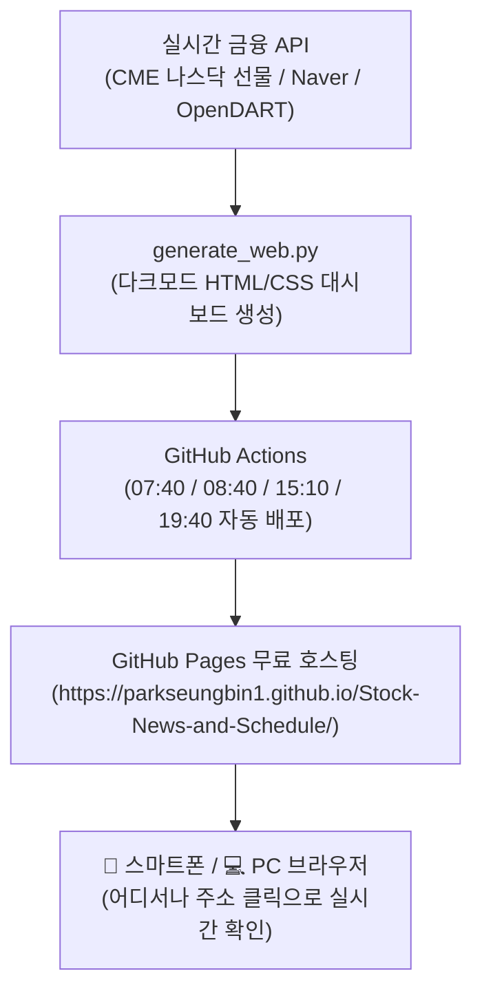

# 🌐 비니stock 실전 트레이딩 웹 대시보드 구축 가이드

본 문서는 **E-mini 나스닥 100 선물, 필라델피아 반도체 지수, 코스피/코스닥 외인·기관 수급, 4대 종가베팅/매도 가이드, 관심종목 핵심 공시**를 한눈에 볼 수 있는 **나만의 다크모드 주식 웹 대시보드**를 구축하고 무료로 인터넷에 띄우는 스텝-바이-스텝 매뉴얼입니다.

---

## 1. 💡 시스템 특징 및 아키텍처



* **비용**: **0원 (평생 무료)** — GitHub Pages 무료 호스팅 활용
* **장점**: 내 PC를 켜둘 필요 없이, 스마트폰이나 태블릿에서 URL 하나로 언제 어디서든 접속 가능
* **디자인**: 전문 트레이더용 프리미엄 다크모드 + 모바일 반응형 최적화

---

## 2. 🖥️ [방법 A] 내 컴퓨터에서 바로 열어보기 (1초 컷)

깃허브에 올리기 전에 내 컴퓨터 화면에서 대시보드가 어떻게 생겼는지 즉시 확인하는 방법입니다:

1. VS Code 터미널에서 다음 명령어를 입력합니다:
   ```bash
   python generate_web.py
   ```
2. 실행이 끝나면 `dist/` 폴더 안에 **`index.html`** 파일이 생성됩니다.
3. 파일 탐색기에서 `dist/index.html` 파일을 **더블 클릭**하거나, 브라우저로 드래그하면 내 컴퓨터 화면에 즉시 멋진 다크모드 대시보드가 뜹니다!

---

## 3. 🚀 [방법 B] 스마트폰으로 언제든 볼 수 있게 인터넷에 무료 배포하기 (추천!)

깃허브의 **무료 GitHub Pages** 기능을 켜서 나만의 인터넷 주소를 만드는 방법입니다.
이미 자동 배포 코드(`.github/workflows/deploy-web.yml`)를 모두 심어두었기 때문에, **대표님께서는 깃허브 웹사이트에서 클릭 2번만** 하시면 됩니다!

### 📌 스텝-바이-스텝 따라하기

#### [Step 1] 깃허브 저장소 페이지 접속
웹 브라우저를 열고 내 저장소 페이지로 들어갑니다:
👉 **`https://github.com/parkseungbin1/Stock-News-and-Schedule`**

#### [Step 2] 저장소 설정(Settings) 메뉴 클릭
저장소 상단 탭 메뉴 중 맨 오른쪽에 있는 **[Settings]** (톱니바퀴 아이콘)를 클릭합니다.

#### [Step 3] Pages 메뉴 이동
화면 왼쪽 사이드바 메뉴에서 **[Code and automation]** 카테고리 아래에 있는 **[Pages]**를 클릭합니다.

#### [Step 4] Source를 GitHub Actions로 변경 (핵심!)
화면 중앙의 **Build and deployment** 항목을 확인합니다:
* **Source**: 기본값인 `Deploy from a branch`로 되어 있는 드롭다운을 클릭하여
* 👉 **`GitHub Actions`** 로 변경 선택합니다!

#### [Step 5] 자동 배포 및 주소 확인 (완료!)
1. 상단 메뉴의 **[Actions]** 탭으로 가보시면 `Deploy Web Dashboard to GitHub Pages` 워크플로가 자동으로 실행되어 파란색/초록색으로 돌아가는 것을 볼 수 있습니다 (약 1~2분 소요).
2. 배포가 완료되면 다시 **[Settings] > [Pages]** 화면으로 오셨을 때 상단에 내 전용 웹사이트 주소가 뜹니다:
   🔗 **`https://parkseungbin1.github.io/Stock-News-and-Schedule/`**

---

## 4. 📱 스마트폰에서 '앱'처럼 사용하는 꿀팁

생성된 주소를 스마트폰 홈 화면에 아이콘으로 추가해 두면, 별도 앱 설치 없이도 홈 화면에서 원터치로 실시간 대시보드를 열어볼 수 있습니다:

### 🍎 아이폰 (Safari)
1. 사파리 브라우저에서 내 대시보드 주소 접속
2. 하단 중앙의 **공유 아이콘** (네모 위로 화살표) 클릭
3. 메뉴에서 **[홈 화면에 추가]** 클릭 ➡️ 이름 지정 후 [추가]

### 🤖 갤럭시 / 안드로이드 (Chrome 또는 삼성 인터넷)
1. 크롬 브라우저에서 내 대시보드 주소 접속
2. 우측 상단 **점 세 개 메뉴(⋮)** 클릭
3. **[홈 화면에 추가]** (또는 앱 설치) 클릭

---

## 5. 📊 대시보드 주요 화면 구성 요약

* 📈 **상단 핵심 지표 바**:
  - 🇺🇸 **E-mini 나스닥 100 선물 (`NQ=F`)** 실시간 등락
  - 💻 **필라델피아 반도체 지수 (`SOX`)**
  - 🇰🇷 **코스피 / 코스닥 지수 및 외인·기관 실시간 수급 금액**
  - 💱 **원/달러 환율** 및 CNN 공포탐욕 지수
* ⏱️ **4대 트레이딩 가이드 탭**:
  - `[07:40 NXT 매도]` / `[08:40 정규장 매도]` / `[15:10 정규장 종가베팅]` / `[19:40 NXT 최종 종가베팅]` 탭을 누르면 각 시간대별 점수와 행동 지침이 즉시 변경 표시됨.
* 📢 **관심종목 핵심 공시 레이더**:
  - 실적 어닝 서프라이즈, 자사주 취득, IR 일정 등 핵심 공시가 카드 형태로 표시되며, 클릭 시 DART 전자공시 원문으로 바로 연결.
