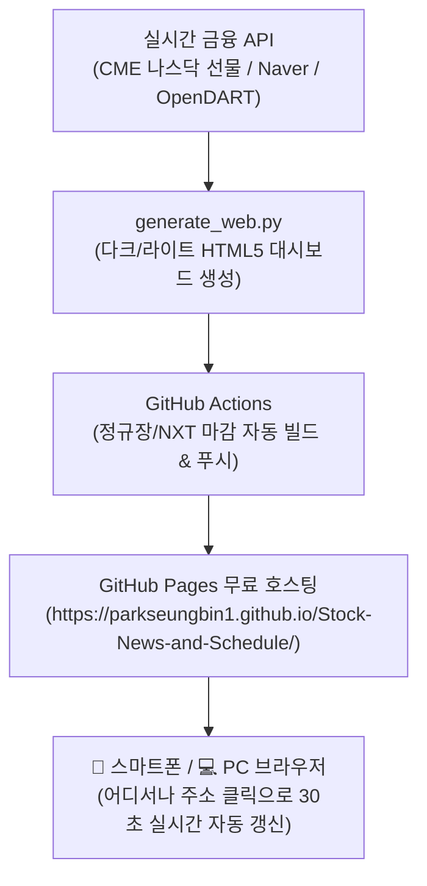

# 🌐 비니stock 실전 트레이딩 웹 대시보드 최종 가이드

본 문서는 **E-mini 나스닥 100 선물, 필라델피아 반도체 지수, 코스피/코스닥 외인·기관 수급, AI 시장 리스크 스코어, 4대 종가베팅/스윙 추천, 시가총액 필터, 스윙 What-If 시뮬레이터, 관심종목 핵심 공시**를 한눈에 볼 수 있는 **나만의 프리미엄 실전 주식 웹 대시보드** 가이드입니다.

---

## 1. 💡 시스템 특징 및 아키텍처 (평생 0원 무료)

* **비용**: **0원 (평생 무료)** — GitHub Pages 무료 정적 웹 호스팅 및 클라이언트 브라우저 렌더링 100% 활용
* **장점**: 내 PC를 켜둘 필요 없이, 스마트폰이나 태블릿에서 URL 하나로 언제 어디서든 접속 가능
* **디자인**: 다크모드 / 라이트모드 원터치 토글 + 전문 트레이더용 반응형 프리미엄 UI

---

## 2. 🛡️ 비용 및 cron-job.org 안심 팩트체크

### Q1. cron-job.org 에서 비용이 청구되나요?
* **결론: 100% 무료(0원)이며, 절대 과금되지 않습니다.**
* **이유**: `cron-job.org`는 무료 회원 가입 시 신용카드 등록 자체가 필요 없으며, 무료 계정 기준 기본 월 5개 작업까지 0원으로 제공됩니다. 무료 한도를 넘기더라도 자동으로 유료 결제가 되는 것이 아니라 단지 실행이 일시 중단될 뿐입니다.
* **스케줄 중단 방법**: 혹시라도 찜찜하시다면 [cron-job.org](https://cron-job.org) 로그인 ➡️ `Dashboard` ➡️ `My Jobs`에서 등록된 작업을 **Pause(일시정지)** 또는 **Delete(삭제)** 하시면 됩니다. 깃허브 자체에 내장된 자동 스케줄러가 있으므로 외부 서비스를 전혀 쓰지 않아도 정상 작동합니다.

### Q2. 대시보드를 켜두거나 새로고침하면 깃허브 액션 비용이 드나요?
* **결론: 평생 0원 (완전 무료)입니다.**
* **이유**: 사용자가 웹페이지를 열어보거나 새로고침(F5)하는 동작은 이미 배포된 깃허브 정적 웹서버(GitHub Pages)의 파일을 읽어올 뿐이며, 깃허브 액션(CI 러너)을 전혀 깨우지 않습니다. 깃허브 액션은 오직 정규장 마감 후(15:35, 20:05) 하루 2회 정해진 시간에만 1분간 실행되므로 한도를 초과할 일이 전혀 없습니다.

---

## 3. 🚀 새로 반영된 5대 핵심 무료 기능

### ① 🛡️ AI 실시간 시장 리스크 스코어 게이지 (0~100점)
* 상단 헤더 바로 아래에 **실시간 시장 위험도**를 직관적으로 분석하여 표시합니다.
* 나스닥 선물, 필라델피아 반도체, 코스피/코스닥 외인 수급, VIX, 환율 등을 복합 가중치로 연산합니다.
  - **🟢 0~34점 (저위험/안정)**: 공격적 매매 및 종가베팅 비중 100% 정상 운용
  - **🟡 35~64점 (중위험/주의)**: 단기 변동성 주의, 분할 매수 및 익절 원칙 준수
  - **🔴 65~100점 (고위험/경고)**: 시장 하방 압력 경계, 현금 비중 50% 이상 확보

### ② 🏷️ 시가총액 필터 & 시총 배지 강조
* 추천 종목 영역 상단에 **시가총액 필터 바**가 추가되었습니다:
  - `전체보기` / `대형주 (1조원+)` / `중형주 (3천억~1조)` / `스몰캡 (3천억 미만)`
* 각 종목 카드 상단에 **시총 배지**가 선명하게 표시되어, 호가창이 얇은 소형주인지 알짜 우량 중대형주인지 한눈에 확인 가능합니다.

### ③ 🎯 스윙 What-If 목표 수익 시뮬레이터
* `[🌊 2~5일 스윙 추천]` 탭 하단에 **스윙 What-If 시뮬레이터 표**가 내장되었습니다.
* 발굴된 스윙 주도주별로:
  - **진입 기준가**, **1차 목표(+3%)**, **2차 목표(+5%)**, **3차 목표(+9%)**, **기준 손절선(-2%)**
* 계산기를 두드릴 필요 없이 정량적 분할 매도 가격을 즉시 확인하고 매매 전략을 수립할 수 있습니다.

### ④ 🌓 다크모드 / 라이트모드 즉시 전환
* 우측 상단 `🌓 라이트모드` 버튼을 누르면 눈이 편안한 화이트/그레이 모드로 즉시 전환됩니다.
* 브라우저에 설정값이 자동 저장되어 다음 접속 시에도 유지됩니다.

### ⑤ ⚡ 글로벌 빅테크 및 ETF 퀵링크
* 헤더 로고 아래에 `나스닥`, `QQQ`, `SPY`, `SOXX`, `NVDA` 바로가기 태그가 제공되어, 미국 증시 흐름을 1초 만에 네이버 증권/야후 파이낸스로 교차 확인 가능합니다.

---

## 4. 📱 스마트폰에서 '앱'처럼 사용하는 꿀팁 (PWA 지원)

대시보드에 PWA(웹앱) 규격(`manifest.json`, `sw.js`)이 적용되어 있어, 홈 화면에 추가하면 전용 앱처럼 전체화면으로 열립니다:

### 🍎 아이폰 (Safari)
1. 사파리 브라우저에서 내 대시보드 주소 접속:
   👉 **`https://parkseungbin1.github.io/Stock-News-and-Schedule/`**
2. 하단 중앙의 **공유 아이콘** (네모 위로 화살표) 클릭
3. 메뉴에서 **[홈 화면에 추가]** 클릭 ➡️ 이름 확인 후 [추가]

### 🤖 갤럭시 / 안드로이드 (Chrome 또는 삼성 인터넷)
1. 크롬 브라우저에서 내 대시보드 주소 접속
2. 우측 상단 **점 세 개 메뉴(⋮)** 클릭
3. **[홈 화면에 추가]** (또는 앱 설치) 클릭

---

## 5. 🛠️ 배포 및 자동 갱신 상태 안내

* **정규 자동 배포 스케줄**:
  * 🎯 **오후 15:10 (KST)**: 15:30 장마감 대비 1차 종가베팅 골든타임 웹 대시보드 실시간 자동 배포
  * 🏁 **오후 15:35 (KST)**: 정규장 마감 후 최종 실적/성과 검증 대시보드 업데이트
  * 🌙 **저녁 20:05 (KST)**: NXT 야간 거래 마감 후 최종 대시보드 업데이트
* **수동 즉시 배포 (GitHub Actions)**:
  * 깃허브 저장소의 **[Actions]** 탭 ➡️ **[Deploy Web Dashboard to GitHub Pages]** ➡️ **[Run workflow]**를 클릭하시면 언제든 클라우드에서 1분 만에 최신 지수로 웹페이지가 배포됩니다.
* **내 PC 초고속 1초 진단 도구 (`실시간_종가베팅_체크.bat`)**:
  * 장중(특히 15:00~15:20) 깃허브 서버 빌드를 기다리지 않고 즉시 현재 나스닥 선물, 반도체 지수, 환율, 수급, AI 리스크 스코어를 확인하고 싶을 때 프로젝트 루트의 **`실시간_종가베팅_체크.bat`**를 더블클릭하시면 2~3초 만에 콘솔 브리핑 및 웹 대시보드를 즉시 열어보실 수 있습니다.

