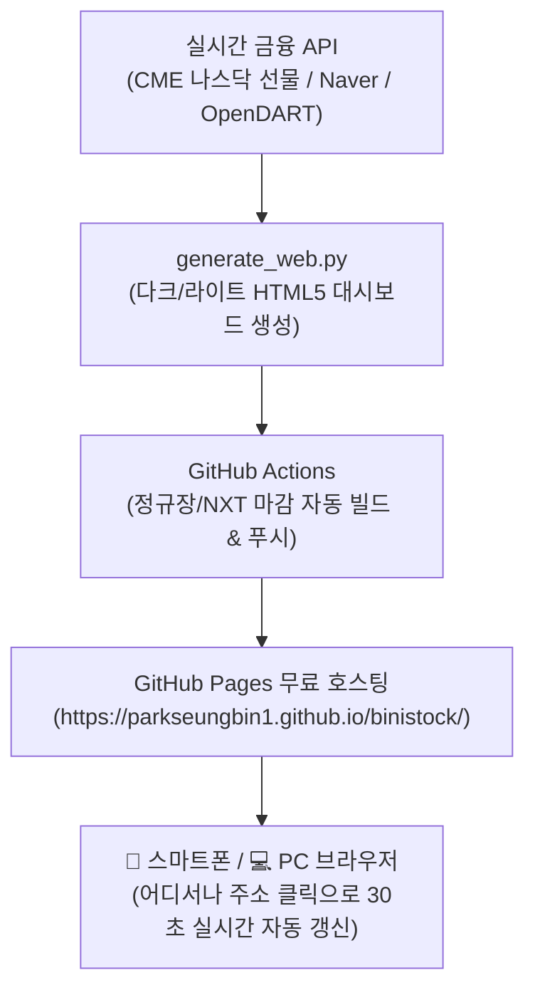

# 🌐 비니stock 실전 트레이딩 웹 대시보드 최종 가이드

본 문서는 **E-mini 나스닥 100 선물, 필라델피아 반도체 지수, 코스피/코스닥 외인·기관 수급, AI 시장 리스크 스코어, 4대 종가베팅/스윙 추천, 시가총액 필터, 스윙 What-If 시뮬레이터, 관심종목 핵심 공시**를 한눈에 볼 수 있는 **나만의 프리미엄 실전 주식 웹 대시보드** 가이드입니다.

---

## 1. 💡 시스템 특징 및 아키텍처 (평생 0원 무료)

* **비용**: **0원 (평생 무료)** — GitHub Pages 무료 정적 웹 호스팅 및 클라이언트 브라우저 렌더링 100% 활용
* **장점**: 내 PC를 켜둘 필요 없이, 스마트폰이나 태블릿에서 URL 하나로 언제 어디서든 접속 가능
* **디자인**: 다크모드 / 라이트모드 원터치 토글 + 전문 트레이더용 반응형 프리미엄 UI

---

## 2. 🛡️ 비용 및 cron-job.org 안심 팩트체크

### Q1. cron-job.org 에서 비용이 청구되나요?
* **결론: 100% 무료(0원)이며, 절대 과금되지 않습니다.**
* **이유**: `cron-job.org`는 무료 회원 가입 시 신용카드 등록 자체가 필요 없으며, 무료 계정 기준 기본 월 5개 작업까지 0원으로 제공됩니다. 무료 한도를 넘기더라도 자동으로 유료 결제가 되는 것이 아니라 단지 실행이 일시 중단될 뿐입니다.
* **스케줄 중단 방법**: 혹시라도 찜찜하시다면 [cron-job.org](https://cron-job.org) 로그인 ➡️ `Dashboard` ➡️ `My Jobs`에서 등록된 작업을 **Pause(일시정지)** 또는 **Delete(삭제)** 하시면 됩니다. 깃허브 자체에 내장된 자동 스케줄러가 있으므로 외부 서비스를 전혀 쓰지 않아도 정상 작동합니다.

### Q2. 대시보드를 켜두거나 새로고침하면 깃허브 액션 비용이 드나요?
* **결론: 평생 0원 (완전 무료)입니다.**
* **이유**: 사용자가 웹페이지를 열어보거나 새로고침(F5)하는 동작은 이미 배포된 깃허브 정적 웹서버(GitHub Pages)의 파일을 읽어올 뿐이며, 깃허브 액션(CI 러너)을 전혀 깨우지 않습니다. 깃허브 액션은 오직 정규장 마감 후(15:35, 20:05) 하루 2회 정해진 시간에만 1분간 실행되므로 한도를 초과할 일이 전혀 없습니다.

---

## 3. 🚀 새로 반영된 5대 핵심 무료 기능

### ① 🛡️ AI 실시간 시장 리스크 스코어 게이지 (0~100점)
* 상단 헤더 바로 아래에 **실시간 시장 위험도**를 직관적으로 분석하여 표시합니다.
* 나스닥 선물, 필라델피아 반도체, 코스피/코스닥 외인 수급, VIX, 환율 등을 복합 가중치로 연산합니다.
  - **🟢 0~34점 (저위험/안정)**: 공격적 매매 및 종가베팅 비중 100% 정상 운용
  - **🟡 35~64점 (중위험/주의)**: 단기 변동성 주의, 분할 매수 및 익절 원칙 준수
  - **🔴 65~100점 (고위험/경고)**: 시장 하방 압력 경계, 현금 비중 50% 이상 확보

### ② 🏷️ 시가총액 필터 & 시총 배지 강조
* 추천 종목 영역 상단에 **시가총액 필터 바**가 추가되었습니다:
  - `전체보기` / `대형주 (1조원+)` / `중형주 (3천억~1조)` / `스몰캡 (3천억 미만)`
* 각 종목 카드 상단에 **시총 배지**가 선명하게 표시되어, 호가창이 얇은 소형주인지 알짜 우량 중대형주인지 한눈에 확인 가능합니다.

### ③ 🎯 스윙 What-If 목표 수익 시뮬레이터
* `[🌊 2~5일 스윙 추천]` 탭 하단에 **스윙 What-If 시뮬레이터 표**가 내장되었습니다.
* 발굴된 스윙 주도주별로:
  - **진입 기준가**, **1차 목표(+3%)**, **2차 목표(+5%)**, **3차 목표(+9%)**, **기준 손절선(-2%)**
* 계산기를 두드릴 필요 없이 정량적 분할 매도 가격을 즉시 확인하고 매매 전략을 수립할 수 있습니다.

### ④ 🌓 다크모드 / 라이트모드 즉시 전환
* 우측 상단 `🌓 라이트모드` 버튼을 누르면 눈이 편안한 화이트/그레이 모드로 즉시 전환됩니다.
* 브라우저에 설정값이 자동 저장되어 다음 접속 시에도 유지됩니다.

### ⑤ ⚡ 글로벌 빅테크 및 ETF 퀵링크
* 헤더 로고 아래에 `나스닥`, `QQQ`, `SPY`, `SOXX`, `NVDA` 바로가기 태그가 제공되어, 미국 증시 흐름을 1초 만에 네이버 증권/야후 파이낸스로 교차 확인 가능합니다.

### ⑥ 🔥 오늘의 최강 주도 섹터 TOP 3 (Sector Sympathy 동조화 레이더)
* 당일 거래대금 상위 급등주들의 업종을 실시간 집계하여 **가장 강하게 자금이 쏠린 주도 섹터 1~3위, 합산 거래대금, 평균 등락률, 대표 대장주**를 한눈에 보여줍니다.
* 주도 섹터에 속한 종목은 AI 추천 점수 산정 시 **섹터 동조화 가산점(`+5점`)**이 자동 부여됩니다.

### ⑦ 💰 AI 리스크 & 하프 켈리(Half-Kelly) 실전 시드머니 계산기
* 나의 총 운용 시드머니(만원)를 입력하면 최근 30일 승률·손익비와 오늘의 AI 리스크 스코어를 결합해:
  - **오늘 권장 총 투입 비중(%) 및 금액**, **의무 현금 보유액**, **1종목당 권장 매수액(3종목 분산)**, **-2% 손절 시 최대 손실액**을 실시간 산출합니다.
* 모든 추천 종목 카드와 스윙 What-If 시뮬레이터 표에 **내 시드 맞춤 권장 매수 주식 수(주)와 익절/손절 예상 원화 금액(원)**이 실시간 연동됩니다.

### ⑧ ⚡ 분봉 VWAP · 상대거래량(RVOL) · 회전율 · NXT 시세 정밀 분석
* 각 추천 종목에 대해 20일 평균 대비 **상대거래량 배수(`RVOL`)**, **시가총액 대비 회전율(`%`)**, **1분봉 기반 당일 VWAP(거래량가중평균단가) 상회 여부 및 고점 형성 시각**을 분석하여 오전 고점 후 흘러내리는 '설거지 패턴'을 원천 배제합니다.
* 08:00~08:50 프리마켓 및 15:40~20:00 야간마켓 시간대에는 **Nextrade(NXT) 실시간 체결가 및 등락률**을 함께 표시합니다.

### ⑨ 🎯 과거 기준봉(+12~15% 돌파) → 5일선·중심선 눌림목 타점 자동 추적
* `[🔥 당일 +15% 돌파 대장주]` 탭 하단에 최근 2~7영업일 내 대량거래 기준봉을 세운 뒤 **거래량이 65% 이하로 건조(숨고르기)되면서 5일선 또는 기준봉 중심선 지지를 받는 실전 눌림목 타점 종목**을 자동으로 발굴하여 제시합니다.

### ⑩ 🧠 DART 공시 선반영 판별기 & 30일 오답노트 자가보정(Self-Tuning)
* **잠정실적 공시**: 최근 10영업일 주가 등락률을 대조하여 `🟢 주가 미반영 알짜 호재`와 `⚠️ 단기 급등 선반영 주의(Sell the News 경계)`를 자동 판별합니다.
* **자사주 취득·소각 공시**: 단순 취득 금액뿐만 아니라 **시가총액 대비 비중(%)**과 **일평균 거래대금 대비 일일 매수 압력(%)**을 계산하여 하방 경직성 강도를 입체 분석합니다.
* **30일 오답노트 자가보정**: 최근 30일 트랙레코드에서 승률이 가장 높은 주도 섹터를 역산하여 추천 엔진에 `+4점` 자가보정 가산점을 피드백합니다.

### ⑪ 📘 실전 200% 활용법 (10대 천재 매매공식) 전용 탭
* 추천 종목 탭 우측 끝에 **`[📘 실전 200% 활용법 (10대 천재 매매공식)]`** 전용 탭이 탑재되었습니다.
* 장중·장마감 매매 시 대시보드를 읽으면서 즉시 대조할 수 있도록 **5대 카테고리 서브 필터**(`🌟 전체 10대 공식`, `⚡ 종가베팅·NXT 시차 (3)`, `📊 수급·차트 맥점 (3)`, `📢 공시·이벤트 알파 (2)`, `💰 자금관리·청산 공식 (2)`)를 지원하며, 각 공식마다 **`👀 대시보드 어디를 보나?`**, **`⚡ 실전 매매 공식 (Action Rule)`**, **`💡 왜 통하는가?`**가 3단 구조로 정리되어 있습니다.

---

## 4. 📱 스마트폰에서 '앱'처럼 사용하는 꿀팁 (PWA 지원)

대시보드에 PWA(웹앱) 규격(`manifest.json`, `sw.js`)이 적용되어 있어, 홈 화면에 추가하면 전용 앱처럼 전체화면으로 열립니다:

### 🍎 아이폰 (Safari)
1. 사파리 브라우저에서 내 대시보드 주소 접속:
   👉 **`https://parkseungbin1.github.io/binistock/`**
2. 하단 중앙의 **공유 아이콘** (네모 위로 화살표) 클릭
3. 메뉴에서 **[홈 화면에 추가]** 클릭 ➡️ 이름 확인 후 [추가]

### 🤖 갤럭시 / 안드로이드 (Chrome 또는 삼성 인터넷)
1. 크롬 브라우저에서 내 대시보드 주소 접속
2. 우측 상단 **점 세 개 메뉴(⋮)** 클릭
3. **[홈 화면에 추가]** (또는 앱 설치) 클릭

---

## 5. 🛠️ 배포 및 모바일/외부PC 실시간 확인 방법

* **📱 길거리(스마트폰) 및 외부 PC 실시간 버튼 지원**:
  * 🔄 **`[실시간 새로고침]` 버튼 (상단 헤더 & 리스크 카드)**:
    * 모바일 브라우저의 강력한 캐시를 즉시 우회하여 깃허브 서버의 최신 데이터를 1초 만에 강제 동기화합니다.
  * ⚡ **`[클라우드 갱신]` 버튼 (상단 헤더)**:
    * 장중 수시로 깃허브 클라우드 서버를 깨워 **실시간 나스닥 선물, 반도체 지수, 환율, 외인/기관 수급을 즉시 재분석 & 재배포**합니다.
    * 모바일에서 클릭 한 번으로 GitHub Actions `[Run workflow]`를 실행할 수 있습니다.
* **⏰ 정규 자동 배포 스케줄 (완전 자동 / 0원 무료)**:
  * 🎯 **오후 15:00 (KST)**: 장마감 30분 전 1차 시장 리스크 수집 및 종가베팅 사전 확인
  * 🎯 **오후 15:10 (KST)**: 15:10 공식 종가베팅 골든타임 웹 대시보드 자동 배포 (텔레그램 동시)
  * 🎯 **오후 15:20 (KST)**: 동시호가 직전 최종 시장 리스크 및 지표 배포
  * 🏁 **오후 15:35 (KST)**: 정규장 마감 후 최종 실적/성과 검증 대시보드 업데이트
  * 🌙 **저녁 20:05 (KST)**: NXT 야간 거래 마감 후 최종 대시보드 업데이트
  * 👉 *평일 15:00~15:20 구간에는 버튼을 누르지 않으셔도 10분마다 깃허브가 스스로 최신화하여 스마트폰으로 전송합니다.*
* **💻 집 PC 전용 옵션 (`실시간_종가베팅_체크.bat`)**:
  * 집에서 PC를 켜두고 계실 때는 프로젝트 폴더의 배치 파일을 더블클릭하여 2초 만에 콘솔 브리핑을 보실 수도 있습니다.

